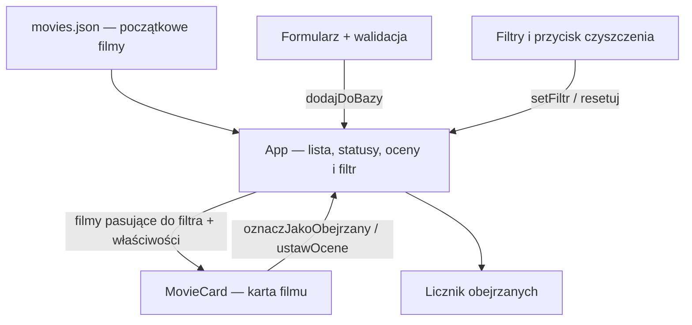

<div align="center">

# 🎬 My Movie List

**Własna lista filmów — dodawanie, oznaczanie obejrzanych i ocenianie.**

React 19 · TypeScript 6 · Vite 8 · React Hook Form 7

</div>

My Movie List to aplikacja przeglądarkowa, w której użytkownik prowadzi listę filmów, zapisuje ich status obejrzenia i wystawia oceny w skali od 1 do 5. Projekt pokazuje pracę z komponentami React, stanem aplikacji, formularzem z walidacją oraz dynamiczną listą pól.

Na starcie aplikacja wczytuje **12 filmów** z pliku [`src/data/movies.json`](src/data/movies.json). Każdy film ma tytuł, rok premiery i gatunek. Użytkownik może rozbudować listę o własne pozycje oraz przypisać im kilka gatunków.

> **Przechowywanie danych:** zmiany są przechowywane w pamięci działającej aplikacji. Odświeżenie strony przywraca początkową listę oraz zeruje oceny i oznaczenia obejrzenia.

## Spis treści

1. [Możliwości aplikacji](#funkcjonalnosci)
2. [Instalacja i uruchomienie](#uruchomienie)
3. [Technologie i struktura projektu](#struktura)
4. [Modele danych](#modele)
5. [Stan aplikacji](#stan)
6. [Funkcje w komponencie App](#funkcje-app)
7. [Formularz i walidacja](#formularz)
8. [Komponent MovieCard](#moviecard)
9. [Filtrowanie i pozostałe funkcje pomocnicze](#filtrowanie)
10. [Uruchomienie React i przepływ danych](#przeplyw)
11. [Wygląd i konfiguracja](#konfiguracja)
12. [Przykład działania](#przyklad)
13. [Ograniczenia obecnej wersji](#ograniczenia)

---

<a id="funkcjonalnosci"></a>

## 1. Możliwości aplikacji

| Funkcja | Jak działa |
| --- | --- |
| **Lista filmów** | Wyświetla karty z tytułem, rokiem premiery i gatunkami. Początkowe dane pochodzą z lokalnego pliku JSON. |
| **Dodawanie filmu** | Formularz zbiera nazwę, rok i gatunki. Po poprawnym wysłaniu dopisuje film na końcu listy i czyści pola. |
| **Wiele gatunków** | Przycisk `+` dodaje kolejne pole gatunku. Przycisk `-` usuwa wybrane pole, gdy formularz zawiera więcej niż jedno. |
| **Status obejrzenia** | Kliknięcie „Dodaj do obejrzanych” oznacza film jako obejrzany. Ponowne kliknięcie przycisku „Obejrzane!” cofa ten status. |
| **Oceny 1–5** | Kliknięcie liczby przypisuje ocenę do filmu. Wybrana liczba jest złota; kliknięcie innej zastępuje poprzednią ocenę. |
| **Filtrowanie** | Przyciski „Wszystkie”, „Obejrzane” i „Nieobejrzane” wybierają filmy widoczne na ekranie. |
| **Licznik obejrzanych** | Nagłówek pokazuje liczbę oznaczonych filmów. Mianownik jest pobierany z początkowego pliku JSON, więc obecnie zawsze wynosi 12. |
| **Czyszczenie oznaczeń** | „Wyczyść wszystkie” usuwa wszystkie oceny i statusy obejrzenia. Dodane filmy pozostają na liście. |
| **Komunikat o pustym widoku** | Gdy żaden film nie pasuje do filtra, pojawia się „Brak filmów do wyświetlenia.”. |

**Ocena i status obejrzenia są niezależne.** Film można ocenić przed oznaczeniem go jako obejrzany. Cofnięcie oznaczenia obejrzenia zachowuje jego ocenę.

<a id="uruchomienie"></a>

## 2. Instalacja i uruchomienie

### Wymagania

- **Node.js:** wersja z linii 20 od `20.19.0` lub wersja `22.12.0` i wyższa. To wymaganie Vite i Oxlint zapisanych w `package-lock.json` (`^20.19.0 || >=22.12.0`).
- **npm:** do instalowania zależności i uruchamiania poleceń projektu.

Aplikacja nie wymaga serwera bazy danych, kluczy API ani pliku `.env`.

### Start lokalny

Otwórz terminal w katalogu projektu, a następnie wykonaj:

```bash
npm ci
npm run dev
```

`npm ci` instaluje zależności zgodnie z plikiem `package-lock.json`. Po uruchomieniu serwera otwórz adres wyświetlony przez Vite w terminalu.

### Polecenia projektu

| Polecenie | Co wykonuje | Kiedy używać |
| --- | --- | --- |
| `npm run dev` | Uruchamia serwer Vite. | Podczas pracy nad aplikacją. |
| `npm run build` | Wykonuje `tsc -b`, a po jego powodzeniu `vite build`. Tworzy pliki produkcyjne w `dist/`. | Przed udostępnieniem gotowej aplikacji. |
| `npm run preview` | Uruchamia lokalny podgląd wersji zbudowanej w `dist/`. | Do obejrzenia wyniku budowania. |
| `npm run lint` | Uruchamia Oxlint z konfiguracją projektu. | Do sprawdzania reguł jakości kodu. |

Aby obejrzeć wersję produkcyjną:

```bash
npm run build
npm run preview
```

Sprawdzanie kodu poleceniem `npm run lint` uruchamia się osobno — nie jest częścią skryptu `build`.

<a id="struktura"></a>

## 3. Technologie i struktura projektu

### Wykorzystane technologie

| Technologia | Rola w projekcie |
| --- | --- |
| **React 19** | Budowa interfejsu z komponentów i aktualizowanie widoku po zmianie stanu. |
| **React DOM 19** | Osadzenie aplikacji React w dokumencie HTML. |
| **TypeScript 6** | Opis struktury filmów, danych formularza, ocen i właściwości komponentów. |
| **React Hook Form 7** | Rejestracja pól, walidacja, obsługa wysyłania formularza i resetowanie jego wartości. |
| **Vite 8** | Uruchamianie projektu podczas pracy i budowanie plików produkcyjnych. |
| **Oxlint 1** | Statyczna analiza kodu zgodnie z regułami w `.oxlintrc.json`. |
| **CSS** | Kolory, odstępy, układ formularza, nawigacji i kart filmów. |

### Układ plików

```text
zadanie-react/
├── public/
│   ├── favicon.svg          # Ikona strony używana przez index.html
│   └── icons.svg            # Zasób graficzny
├── src/
│   ├── assets/              # Zasoby graficzne projektu
│   ├── components/
│   │   └── MovieCard.tsx     # Karta pojedynczego filmu
│   ├── data/
│   │   └── movies.json       # Początkowe 12 filmów
│   ├── App.tsx              # Stan, formularz, filtry i główny widok
│   ├── App.css              # Style interfejsu
│   └── main.tsx             # Uruchomienie aplikacji React
├── index.html               # Dokument HTML z kontenerem root
├── package.json             # Zależności i polecenia npm
├── package-lock.json        # Dokładne wersje zależności
├── tsconfig.json            # Powiązanie konfiguracji TypeScript
├── tsconfig.app.json        # Konfiguracja kodu aplikacji
├── tsconfig.node.json       # Konfiguracja pliku vite.config.ts
├── vite.config.ts           # Konfiguracja Vite z wtyczką React
├── .oxlintrc.json            # Reguły analizy kodu
├── .gitignore               # Pliki pomijane przez Git
└── README.md                # Dokumentacja projektu
```

Główna logika znajduje się w [`App.tsx`](src/App.tsx). [`MovieCard.tsx`](src/components/MovieCard.tsx) odpowiada za wyświetlanie pojedynczego filmu i przekazywanie kliknięć do funkcji otrzymanych od `App`.

<a id="modele"></a>

## 4. Modele danych

### `Movie` — pojedynczy film

```ts
interface Movie {
  id: number;
  title: string;
  year: number;
  genre: string[];
}
```

| Pole | Znaczenie |
| --- | --- |
| `id` | Identyfikator używany do powiązania filmu ze statusem obejrzenia i oceną. Jest również kluczem `key` podczas tworzenia kart. |
| `title` | Tytuł wyświetlany na karcie. |
| `year` | Rok premiery. |
| `genre` | Tablica gatunków, np. `["Sci-Fi", "Drama"]`. |

W początkowym pliku JSON gatunek jest pojedynczym tekstem, np. `"Sci-Fi"`. Przy tworzeniu stanu aplikacja zamienia go na tablicę:

```ts
movies.map(movie => ({
  ...movie,
  genre: Array.isArray(movie.genre) ? movie.genre : [movie.genre],
}))
```

`map()` tworzy nową listę obiektów, `...movie` kopiuje dane filmu, a `Array.isArray()` sprawdza format gatunku. Dzięki temu zarówno filmy z JSON, jak i filmy dodane przez formularz mają w stanie aplikacji ten sam format `genre`.

### `FormData` — wartości formularza

```ts
interface FormData {
  nazwa: string;
  rok: number;
  typ: { value: string }[];
}
```

Dane formularza mają inne nazwy pól niż obiekt filmu. Funkcja `dodajDoBazy()` przekształca `nazwa` w `title`, `rok` w `year`, a obiekty z `typ` w tablicę tekstów `genre`.

Przykład danych wysyłanych przez formularz:

```ts
{
  nazwa: "Dune",
  rok: 2021,
  typ: [{ value: "Sci-Fi" }, { value: "Adventure" }]
}
```

### `Oceny` — oceny przypisane do identyfikatorów

```ts
type Oceny = Record<number, number>;
```

To obiekt, w którym kluczem jest identyfikator filmu, a wartością jego ocena. Przykładowe `{ 1: 5, 3: 4 }` oznacza ocenę `5` dla filmu o ID `1` i ocenę `4` dla filmu o ID `3`.

Ocena nie jest zapisywana wewnątrz obiektu `Movie`. Brak wpisu oznacza brak oceny; na potrzeby karty jest wtedy przekazywana wartość `0`.

<a id="stan"></a>

## 5. Stan aplikacji

Komponent `App` korzysta z pięciu stanów utworzonych przez `useState()`:

| Stan | Wartość początkowa | Funkcja aktualizująca | Za co odpowiada |
| --- | --- | --- | --- |
| `filmy` | Filmy z JSON po ujednoliceniu `genre`. | `setFilm()` | Pełna lista filmów, także tych dodanych przez użytkownika. |
| `lastId` | `movies.length`, obecnie `12`. | `setLastId()` | Licznik wykorzystywany przy nadawaniu ID nowemu filmowi. |
| `obejrzane` | Pusta tablica `[]`. | `setObejrzane()` | Identyfikatory filmów oznaczonych jako obejrzane. |
| `filtr` | `"wszystkie"`. | `setFiltr()` | Aktywny sposób filtrowania listy. |
| `oceny` | Pusty obiekt `{}`. | `setOceny()` | Oceny powiązane z identyfikatorami filmów. |

Funkcje `setFilm`, `setLastId`, `setObejrzane`, `setFiltr` i `setOceny` są dostarczane przez React. Ich wywołanie z nową wartością aktualizuje odpowiedni stan, na podstawie którego React ponownie wylicza widok.

W zapisach takich jak `setFilm((prev) => ...)` parametr `prev` oznacza poprzednią wartość danego stanu. Aktualizacje list i obiektów tworzą nowe tablice lub obiekty, zamiast bezpośrednio zmieniać istniejące dane.

`wyswietlaneFilmy` jest obliczane z `filmy`, `filtr` i `obejrzane`. Nie ma własnego `useState()`, ponieważ wynika z pozostałych danych.

<a id="funkcje-app"></a>

## 6. Funkcje w komponencie App

### `App()` — główny komponent

**Plik:** [`src/App.tsx`](src/App.tsx)

`App()` łączy logikę i widok całej aplikacji. Inicjalizuje stany, konfiguruje formularz, definiuje funkcje reagujące na działania użytkownika i wybiera filmy do wyświetlenia.

Zwraca JSX, czyli opis interfejsu składającego się z czterech części:

1. **Nagłówek** — licznik obejrzanych filmów.
2. **Formularz** — dodawanie filmu i wyświetlanie błędów walidacji.
3. **Nawigacja** — wybór filtra oraz przycisk resetowania ocen i oznaczeń.
4. **Lista** — komponenty `MovieCard` albo komunikat o braku filmów pasujących do filtra.

`App` przechowuje wspólne dane. Karty otrzymują ich aktualne wartości oraz funkcje, które pozwalają je zmienić.

### `dodajDoBazy(data: FormData)` — dodawanie filmu

**Wywołanie:** po wysłaniu formularza, jeśli jego walidacja zakończy się powodzeniem.

**Argument:** obiekt zawierający nazwę filmu, rok i tablicę pól gatunków.

Funkcja wykonuje kolejno następujące czynności:

1. Wypisuje dane formularza w konsoli przeglądarki przez `console.log()`.
2. Zwiększa licznik `lastId` o jeden.
3. Tworzy film z identyfikatorem `lastId + 1`, tytułem z `data.nazwa` i rokiem z `data.rok`.
4. Przekształca pola gatunków w tablicę tekstów i pomija wartości zawierające wyłącznie białe znaki.
5. Dopisuje nowy film na końcu tablicy `filmy`.
6. Czyści formularz i pozostawia jedno puste pole gatunku.

Kluczowy fragment:

```ts
setLastId((prev) => prev + 1);
setFilm((prev) => [
  ...prev,
  {
    id: lastId + 1,
    title: data.nazwa,
    year: data.rok,
    genre: data.typ.map((t) => t.value).filter((v) => v.trim().length > 0),
  },
]);
reset({ nazwa: "", rok: undefined, typ: [{ value: "" }] });
```

`...prev` zachowuje dotychczasowe filmy. `setLastId()` planuje zmianę stanu; w tym wywołaniu `lastId` nadal ma wartość z bieżącego renderowania, dlatego nowy film otrzymuje `lastId + 1`. Przy obecnych danych pierwszy dodany film ma ID `13`.

Nowy film zaczyna jako **nieobejrzany i bez oceny**. Jeśli aktywny jest filtr „Obejrzane”, film zostanie dodany, ale pojawi się dopiero po zmianie filtra.

Pomimo nazwy funkcji zapis odbywa się w stanie React. Funkcja nie wysyła żądania do bazy danych ani nie modyfikuje pliku JSON.

### `oznaczJakoObejrzany(id: number)` — przełączanie statusu

**Wywołanie:** kliknięcie przycisku statusu na karcie filmu.

**Argument:** identyfikator filmu, którego status ma się zmienić.

```ts
function oznaczJakoObejrzany(id: number) {
  setObejrzane((prev) =>
    prev.includes(id) ? prev.filter((item) => item !== id) : [...prev, id]
  );
}
```

Funkcja działa jak przełącznik:

- `includes(id)` sprawdza, czy film jest już oznaczony.
- Jeśli tak, `filter()` tworzy tablicę bez jego identyfikatora.
- Jeśli nie, `[...prev, id]` dopisuje identyfikator do listy obejrzanych.

Przykład dla filmu o ID `3`: `[]` → `[3]` → `[]` po dwóch kolejnych kliknięciach.

Zmiana aktualizuje napis na przycisku, licznik w nagłówku i listę wynikającą z aktywnego filtra. Ocena filmu pozostaje zachowana. Przy filtrze „Nieobejrzane” oznaczona karta od razu znika z widoku.

### `ustawOcene(id: number, ocena: number)` — zapisywanie oceny

**Wywołanie:** kliknięcie jednej z liczb `1`, `2`, `3`, `4`, `5` na karcie.

**Argumenty:** identyfikator filmu i wybrana ocena.

```ts
function ustawOcene(id: number, ocena: number) {
  setOceny((prev) => ({
    ...prev,
    [id]: ocena,
  }));
}
```

`...prev` zachowuje oceny pozostałych filmów. Zapis `[id]: ocena` ustawia lub zastępuje ocenę filmu o wskazanym identyfikatorze.

Przykładowo, wywołanie `ustawOcene(3, 4)` przy stanie `{ 1: 5 }` daje `{ 1: 5, 3: 4 }`. Kolejne wywołanie `ustawOcene(3, 2)` zmienia tylko ocenę filmu `3`.

Zakres `1–5` wynika z przycisków wyboru w interfejsie; sama funkcja nie zawiera dodatkowego sprawdzenia zakresu. Ponowne wybranie tej samej liczby pozostawia ocenę. Nie przełącza jej na „brak oceny”.

### `resetuj()` — czyszczenie statusów i ocen

**Wywołanie:** kliknięcie „Wyczyść wszystkie”. Funkcja nie przyjmuje argumentów.

```ts
function resetuj() {
  setObejrzane([]);
  setOceny({});
}
```

Po wywołaniu wszystkie filmy stają się nieobejrzane, wszystkie oceny znikają, a licznik obejrzanych pokazuje `0`.

| Element | Stan po użyciu „Wyczyść wszystkie” |
| --- | --- |
| Oznaczenia obejrzenia | Usunięte. |
| Oceny | Usunięte. |
| Lista filmów, także dodanych | Zachowana. |
| Wybrany filtr | Zachowany. |
| Zawartość aktualnie wypełnianego formularza | Zachowana. |
| Licznik identyfikatorów `lastId` | Zachowany. |

Jeśli aktywny był filtr „Obejrzane”, po resecie lista będzie pusta. Kliknięcie „Wszystkie” ponownie pokaże filmy.

<a id="formularz"></a>

## 7. Formularz i walidacja

### `useForm<FormData>()` — zarządzanie formularzem

Hook konfiguruje pola i dostarcza narzędzia do ich obsługi. Wartości początkowe to pusta nazwa, niewpisany rok (`undefined`) i jedno puste pole gatunku:

```ts
defaultValues: {
  nazwa: "",
  rok: undefined,
  typ: [{ value: "" }],
}
```

| Narzędzie | Co robi w tej aplikacji |
| --- | --- |
| `register(nazwaPola, reguły)` | Łączy pole HTML z formularzem i przypisuje zasady walidacji. Obsługuje `nazwa`, `rok` oraz pola `typ.${index}.value`. |
| `handleSubmit(dodajDoBazy)` | Tworzy obsługę wysłania formularza. Sprawdza dane i wywołuje `dodajDoBazy` po udanej walidacji. |
| `reset(wartości)` | Przywraca wskazane wartości formularza po dodaniu filmu. Nie jest to funkcja `resetuj()` od ocen i obejrzanych. |
| `control` | Obiekt przekazywany do `useFieldArray`, który wiąże dynamiczne pola gatunków z formularzem. |
| `formState.errors` | Zawiera błędy walidacji używane do wyświetlania komunikatów pod polami. |

### Reguły walidacji

| Pole | Zasada | Komunikat w interfejsie |
| --- | --- | --- |
| Nazwa | Pole obowiązkowe. | „Nazwa filmu jest wymagana” |
| Nazwa | Co najmniej 2 znaki. | „Nazwa musi mieć co najmniej 2 znaki” |
| Rok | Pole obowiązkowe. | „Rok jest wymagany” |
| Rok | Wartość nie mniejsza niż 1888. | „Podaj poprawny rok” |
| Rok | Wartość nie większa niż bieżący rok. | „Rok nie może być z przyszłości” |
| Typ / gatunek | Każde widoczne pole jest obowiązkowe. | „Uzupełnij wszystkie pola typu” |

`valueAsNumber: true` zamienia wartość pola roku na liczbę przed przekazaniem jej do funkcji dodającej film. Górny limit jest obliczany przez `new Date().getFullYear()` w przeglądarce.

Dla każdego pola gatunku zapisano regułę z komunikatem „Typ nie może być pusty”, ale interfejs wyświetla wspólny komunikat o konieczności uzupełnienia wszystkich pól typu.

### `useFieldArray()` — dynamiczne gatunki

Hook zarządza tablicą `typ` i udostępnia:

| Element | Działanie |
| --- | --- |
| `fields` | Lista pól, na podstawie której powstają kolejne wiersze formularza. Każde pole ma własne `field.id` używane jako `key`. |
| `append({ value: "" })` | Dodaje na końcu nowe, puste pole gatunku. Wywoływane przez przycisk `+`. |
| `remove(index)` | Usuwa pole o wskazanym indeksie. Wywoływane przez przycisk `-`. |

Przycisk `+` znajduje się tylko przy ostatnim polu. Przyciski `-` są dostępne, gdy pól jest więcej niż jedno, dzięki czemu przez interfejs nie można usunąć ostatniego pola.

Przyciski `+` i `-` mają `type="button"`, więc zmieniają pola bez wysyłania formularza. Wysłanie następuje przez przycisk „Dodaj” z `type="submit"`.

<a id="moviecard"></a>

## 8. Komponent MovieCard

### `MovieCard(props: MovieCardProps)` — karta filmu

**Plik:** [`src/components/MovieCard.tsx`](src/components/MovieCard.tsx)

Komponent zwraca JSX pojedynczej karty: tytuł, rok, gatunki, przycisk statusu i pięć liczb do wyboru oceny. Nie ma własnego stanu. Wyświetla dane otrzymane od `App`, a działania użytkownika przekazuje przez otrzymane funkcje.

### Właściwości komponentu

| Właściwość | Typ | Zastosowanie |
| --- | --- | --- |
| `title` | `string` | Tytuł filmu w nagłówku karty. |
| `year` | `number` | Rok premiery. |
| `genre` | `string[]` | Lista gatunków łączona przez `join(", ")` w jeden tekst. |
| `czyObejrzane` | `boolean` | Decyduje o napisie przycisku statusu. |
| `oznaczJakoObejrzany` | `() => void` | Funkcja uruchamiana po kliknięciu przycisku statusu. |
| `ocena` | `number` | Aktualna ocena; `0` oznacza, że żadna liczba nie jest wyróżniona. |
| `ustawOcene` | `(ocena: number) => void` | Funkcja uruchamiana po kliknięciu liczby oceny. |

### Powiązanie kliknięcia z właściwym filmem

Podczas tworzenia karty `App` przekazuje funkcje z przypisanym identyfikatorem:

```tsx
oznaczJakoObejrzany={() => oznaczJakoObejrzany(movie.id)}
ustawOcene={(ocena: number) => ustawOcene(movie.id, ocena)}
```

Pierwsza funkcja nie wymaga argumentu od karty, ponieważ zna już `movie.id`. Druga odbiera wybraną ocenę i uzupełnia ją o identyfikator. Dzięki temu karta nie musi otrzymywać ID jako osobnej właściwości.

### Wyświetlanie statusu i ocen

Napis przycisku zależy od `czyObejrzane`:

```tsx
{props.czyObejrzane ? "Obejrzane!" : "Dodaj do obejrzanych"}
```

Oceny powstają przez przejście po tablicy `[1, 2, 3, 4, 5]`. Kliknięcie liczby wywołuje `props.ustawOcene(numer)`, a jej kolor zależy od porównania z aktualną oceną:

```tsx
style={{ color: numer === props.ocena ? "gold" : "black" }}
```

Złota jest wyłącznie wybrana liczba. Przykładowo dla oceny `4` wyróżniona jest sama `4`, a nie liczby od `1` do `4`.

<a id="filtrowanie"></a>

## 9. Filtrowanie i pozostałe funkcje pomocnicze

### Obliczanie `wyswietlaneFilmy`

```ts
const wyswietlaneFilmy = filmy.filter((movie) => {
  if (filtr === "obejrzane") return obejrzane.includes(movie.id);
  if (filtr === "nieobejrzane") return !obejrzane.includes(movie.id);
  return true;
});
```

Funkcja przekazana do `filter()` jest wykonywana dla każdego filmu. Zwrócone `true` pozostawia film w widoku, a `false` go pomija.

| Aktywny filtr | Warunek pokazania filmu |
| --- | --- |
| `"wszystkie"` | Każdy film trafia do wyniku. |
| `"obejrzane"` | ID filmu znajduje się w tablicy `obejrzane`. |
| `"nieobejrzane"` | ID filmu nie znajduje się w tablicy `obejrzane`. |

Przyciski nawigacji wywołują odpowiednio `setFiltr("wszystkie")`, `setFiltr("obejrzane")` lub `setFiltr("nieobejrzane")`. Filtrowanie zachowuje kolejność i zawartość źródłowej listy `filmy`.

### Funkcje anonimowe i przekształcenia danych

Oprócz funkcji nazwanych kod korzysta z krótkich funkcji przekazywanych do metod tablic oraz obsługi zdarzeń:

| Fragment | Zadanie |
| --- | --- |
| `movies.map(movie => ...)` | Przygotowuje początkowe filmy, ujednolicając gatunki do tablic. |
| `(prev) => prev + 1` w `setLastId` | Zwiększa licznik ID na podstawie poprzedniej wartości. |
| `(prev) => [...prev, nowyFilm]` w `setFilm` | Tworzy listę z zachowanymi filmami i nową pozycją na końcu. `nowyFilm` oznacza tu obiekt tworzony w funkcji dodającej. |
| `data.typ.map((t) => t.value)` | Pobiera tekst z każdego obiektu pola gatunku. |
| `.filter((v) => v.trim().length > 0)` | Odrzuca gatunki puste lub złożone wyłącznie z białych znaków. |
| `prev.filter((item) => item !== id)` | Usuwa ID filmu z listy obejrzanych. |
| `fields.map((field, index) => ...)` | Tworzy pola gatunków i ich przyciski na podstawie tablicy formularza. |
| `() => append({ value: "" })` | Dodaje pole po kliknięciu `+`. |
| `() => remove(index)` | Usuwa konkretne pole po kliknięciu `-`. |
| `() => setFiltr(...)` | Zmienia filtr po kliknięciu przycisku nawigacji. |
| `wyswietlaneFilmy.map((movie) => ...)` | Tworzy po jednej karcie dla każdego filmu pasującego do filtra. |
| `() => oznaczJakoObejrzany(movie.id)` | Przekazuje do funkcji statusu ID filmu z danej karty. |
| `(ocena) => ustawOcene(movie.id, ocena)` | Łączy ocenę wybraną na karcie z ID filmu. |
| `[1, 2, 3, 4, 5].map((numer) => ...)` | Tworzy pięć klikalnych liczb oceny. |
| `() => props.ustawOcene(numer)` | Przekazuje klikniętą liczbę z karty do jej funkcji obsługi. |

Zapis `() => ...` pozwala odłożyć wywołanie do momentu kliknięcia. Przyciski otrzymują funkcję do wykonania, zamiast wykonywać zmianę podczas tworzenia widoku.

### Wyświetlanie listy i licznika

Przed utworzeniem kart aplikacja sprawdza `wyswietlaneFilmy.length > 0`. Jeśli warunek nie jest spełniony, pokazuje komunikat o pustej liście.

Do każdej karty przekazywane są między innymi:

- `czyObejrzane={obejrzane.includes(movie.id)}` — informacja o statusie danego filmu;
- `ocena={oceny[movie.id] || 0}` — zapisana ocena albo `0`, gdy wpis nie istnieje;
- `key={movie.id}` — klucz pozwalający React rozpoznawać elementy listy; nie jest zwykłą właściwością `MovieCardProps`.

Nagłówek korzysta z `obejrzane.length` i `movies.length`. Zmiana filtra nie zmienia licznika: pokazuje on status całej kolekcji, niezależnie od aktualnie widocznych kart. Szczegół dotyczący stałego mianownika opisano w [ograniczeniach](#ograniczenia).

<a id="przeplyw"></a>

## 10. Uruchomienie React i przepływ danych

### Punkt wejścia — `main.tsx`

```tsx
createRoot(document.getElementById("root")!).render(
  <StrictMode>
    <App />
  </StrictMode>
);
```

1. `index.html` tworzy element `<div id="root"></div>` i wczytuje moduł `src/main.tsx`.
2. `document.getElementById("root")` znajduje ten element w dokumencie.
3. Znak `!` informuje TypeScript, że programista zakłada istnienie elementu. Nie tworzy go ani nie sprawdza w czasie działania.
4. `createRoot()` przygotowuje miejsce renderowania React.
5. `render()` osadza główny komponent `App` wewnątrz `StrictMode`.
6. `StrictMode` włącza dodatkowe kontrole React podczas pracy deweloperskiej. Nie dodaje widocznego elementu interfejsu.

### Jak dane krążą w aplikacji



`App` jest wspólnym miejscem przechowywania danych. Zmieniony stan trafia do kart jako nowe właściwości, więc kliknięcie na jednej karcie może od razu zmienić również licznik i wynik filtrowania.

<a id="konfiguracja"></a>

## 11. Wygląd i konfiguracja

### Style w `App.css`

| Selektor | Odpowiedzialność |
| --- | --- |
| `*` | Ustawia `box-sizing: border-box`, aby padding i obramowanie mieściły się w zadanej szerokości. |
| `body` | Ustawia czcionkę Arial, jasnoszare tło, kolor tekstu i usuwa domyślny margines. |
| `header`, `header h1` | Tworzą zielony nagłówek z białym, wyśrodkowanym licznikiem. |
| `#formularz`, `input`, `select`, `form button` | Definiują białe tło formularza, odstępy, pola i zielone przyciski. Selektor `select` jest przygotowany w CSS, choć obecny formularz używa pól `input`. |
| `nav`, `nav button`, `#wybor` | Układają przyciski nawigacji w rzędzie i nadają im odstępy oraz kolory. |
| `main` | Ogranicza szerokość obszaru listy i ustawia marginesy. |
| `#box`, `#box h2`, `#box button` | Nadają kartom białe tło, obramowanie i styl przycisku statusu. |
| `#ocena` | Dodaje odstępy wokół liczb oceny. Złoty kolor wyboru jest ustawiany bezpośrednio w JSX. |
| `:hover` przy przyciskach | Zmienia wygląd przycisku po najechaniu kursorem zgodnie z regułami CSS. |
| `main > h2` | Wyśrodkowuje i koloruje komunikat o pustej liście. |

### Pliki konfiguracyjne

- **`vite.config.ts`** — eksportuje konfigurację przez `defineConfig()` i włącza wtyczkę React przez `react()` w tablicy `plugins`.
- **`tsconfig.json`** — łączy konfiguracje aplikacji i pliku Vite przez `references`.
- **`tsconfig.app.json`** — obejmuje katalog `src`, ustawia obsługę JSX (`react-jsx`) i kontrolę m.in. nieużywanych zmiennych oraz parametrów.
- **`tsconfig.node.json`** — obejmuje `vite.config.ts` i udostępnia typy Node.js dla konfiguracji narzędzia.
- **`.oxlintrc.json`** — włącza zestawy reguł React, TypeScript i Oxc; ustawia błąd dla naruszeń zasad hooków oraz ostrzeżenie dotyczące eksportów komponentów.
- **`.gitignore`** — wyklucza m.in. `node_modules`, `dist`, logi i wybrane pliki edytorów z zapisu w Git.

<a id="przyklad"></a>

## 12. Przykład działania

Poniższy scenariusz pokazuje, jak współpracują funkcje aplikacji:

| Krok | Działanie | Rezultat |
| --- | --- | --- |
| 1 | Otwórz aplikację. | Widoczne jest 12 filmów; licznik pokazuje `0 / 12`. |
| 2 | Dodaj „Dune”, rok `2021`, gatunki „Sci-Fi” i „Adventure”. | Powstaje film o ID `13`, formularz się czyści, a lista „Wszystkie” zawiera 13 pozycji. |
| 3 | Wybierz ocenę `5` na nowej karcie. | Liczba `5` staje się złota. Film nadal jest nieobejrzany. |
| 4 | Kliknij „Dodaj do obejrzanych” na tej karcie. | Status zmienia się na obejrzany, a licznik pokazuje `1 / 12`. |
| 5 | Włącz filtr „Obejrzane”. | Widoczny jest tylko dodany film. |
| 6 | Kliknij „Wyczyść wszystkie”. | Ocena i status znikają. Filtr pozostaje włączony, więc widoczny jest komunikat o braku filmów. |
| 7 | Kliknij „Wszystkie”. | Ponownie widać 13 filmów, wszystkie bez ocen i oznaczeń obejrzenia. |
| 8 | Odśwież stronę. | Wraca początkowe 12 filmów z JSON. Dodana pozycja znika. |

<a id="ograniczenia"></a>

## 13. Ograniczenia obecnej wersji

Dokumentacja opisuje zachowanie aktualnego kodu. Przy korzystaniu z aplikacji lub jej rozwijaniu należy uwzględnić:

- **Brak trwałego zapisu.** Projekt nie zapisuje zmian do backendu, pliku JSON ani `localStorage`. Zamknięcie lub odświeżenie strony usuwa zmiany użytkownika.
- **Stały mianownik licznika.** Nagłówek korzysta z `movies.length`, czyli początkowych 12 filmów, zamiast z aktualnego `filmy.length`. Po dodaniu i oznaczeniu kolejnych pozycji możliwy jest wynik większy niż `12 / 12`.
- **Identyfikatory zależne od danych początkowych.** `lastId` startuje od liczby rekordów, nie od największego ID. Obecne dane mają identyfikatory od 1 do 12. Przy ręcznej zmianie JSON na inne ID mechanizm może nadać identyfikator już używany przez inny film.
- **Ograniczona normalizacja tekstu.** Nazwa nie jest przycinana przez `trim()`. W gatunkach `trim()` służy tylko do odrzucenia pustych wartości; pozostałe teksty zachowują początkowe i końcowe spacje. Pola zawierające same spacje mogą przejść walidację `required`, po czym gatunki zostaną odfiltrowane przy zapisie.
- **Brak kontroli powtórzeń.** Formularz pozwala dodać ponownie ten sam tytuł oraz powtórzyć gatunek.
- **Zakres operacji.** Interfejs nie udostępnia edycji i usuwania filmu, wyszukiwania, sortowania ani usuwania pojedynczej oceny. Wszystkie oceny można wyczyścić wspólnym przyciskiem.
- **Dalsze dopracowanie interfejsu.** Oceny są klikalnymi elementami `span` bez obsługi klawiatury; część identyfikatorów HTML powtarza się na wielu elementach. Arkusz CSS nie zawiera osobnych reguł dla małych ekranów.

W `package.json` nie ma obecnie polecenia uruchamiającego testy automatyczne. Dostępne polecenia weryfikacyjne to `npm run build` oraz `npm run lint`.
